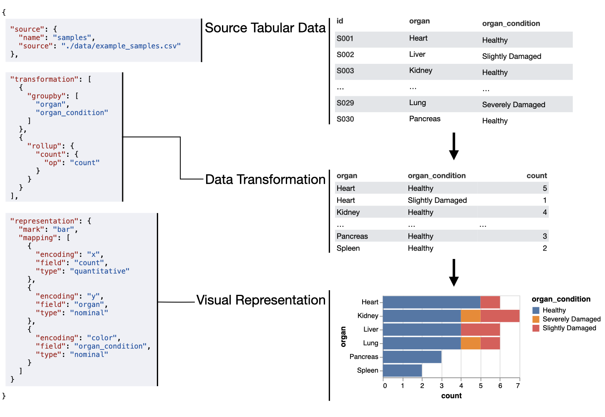

import { LinkCard, CardGrid } from '@astrojs/starlight/components';

The **Universal Discovery Interface** is a research project that aims to improve biomedical data portal interfaces. An essential component is its **visualization grammar**, a JSON format that can describe many different visualizations. Every chart in YAC is a grammar spec, rendered by the [`udi-toolkit`](/udi-yac/docs/integrate/toolkit/) component.

The grammar uses principles from [The Grammar of Graphics](https://link.springer.com/book/10.1007/0-387-28695-0), which also underlies libraries like [Vega-Lite](https://vega.github.io/vega-lite/) and [ggplot2](https://ggplot2.tidyverse.org/). A spec has three sections:

- **`source`** defines the tabular data sources.
- **`transformation`** (optional) reshapes the source data: grouping, aggregating, joining, deriving and filtering.
- **`representation`** maps fields of the transformed data to visual encodings, as chart marks or table rows.

<CardGrid>
  <LinkCard
    title="Tutorial"
    description="Build a heatmap of HuBMAP datasets step by step."
    href="/udi-yac/grammar/tutorial/"
  />
  <LinkCard
    title="Examples"
    description="Tables, bar charts, scatterplots, heatmaps and distributions."
    href="/udi-yac/grammar/examples/"
  />
  <LinkCard
    title="HuBMAP examples"
    description="Charts of live metadata from the HuBMAP Data Portal."
    href="/udi-yac/grammar/hubmap/"
  />
  <LinkCard
    title="Editor"
    description="Write a spec and see the chart as you type."
    href="/udi-yac/grammar/editor/"
  />
</CardGrid>

The full reference for every field is in the [grammar toolkit docs](/udi-yac/docs/integrate/toolkit/).

